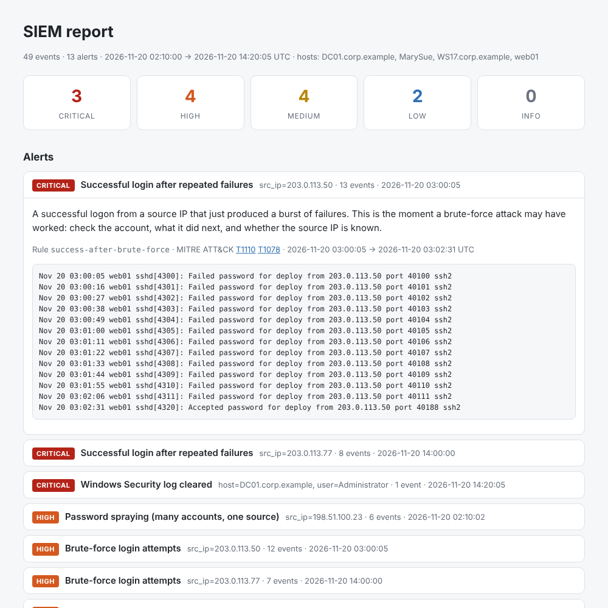

# siem_tool

A lightweight SIEM for learning detection engineering. It parses Linux and Windows logs into one event schema, runs YAML detection rules mapped to **MITRE ATT&CK**, and produces alerts as a console table, JSON, or a self-contained HTML report.

It covers the core SOC workflow end to end: **collect → parse → normalize → detect → alert → investigate**.



## Quick start

```bash
git clone https://github.com/cntcheatkarma-stack/siem_tool
cd siem_tool
pip install -e ".[dev]"

siem run samples/ --year 2026 --html report.html
```

```
SEVERITY  FIRST SEEN (UTC)     RULE                           SUMMARY
CRITICAL  2026-11-20 03:00:05  success-after-brute-force      Successful login after repeated failures (src_ip=203.0.113.50, 13 events)
CRITICAL  2026-11-20 14:00:00  success-after-brute-force      Successful login after repeated failures (src_ip=203.0.113.77, 8 events)
CRITICAL  2026-11-20 14:20:05  audit-log-cleared              Windows Security log cleared (host=DC01.corp.example, user=Administrator, 1 event)
HIGH      2026-11-20 02:10:02  password-spray                 Password spraying (many accounts, one source) (src_ip=198.51.100.23, 6 events)
HIGH      2026-11-20 03:00:05  brute-force-login              Brute-force login attempts (src_ip=203.0.113.50, 12 events)
...
```

Open `report.html` in a browser. There's also a pre-generated [sample report](docs/sample-report.html) and [JSON export](docs/sample-alerts.json).

## Commands

| Command | What it does |
|---|---|
| `siem run LOGS...` | Parse and detect in one step, with no database |
| `siem ingest LOGS... --db siem.db` | Parse logs into SQLite. Re-ingesting the same file doesn't create duplicates |
| `siem detect --db siem.db` | Run rules over everything stored so far |
| `siem rules` | List the loaded rules |

Output options for `run` and `detect`:

- `--html FILE` and `--json FILE` write a report
- `--min-severity high` hides lower-severity alerts
- `--rules DIR` uses your own rule set
- `--fail-on critical` exits with code 2, so a pipeline can gate on findings

## Supported logs

| Source | Format | Events normalized |
|---|---|---|
| Linux `auth.log` / `secure` | syslog (`Nov 20 03:00:05 …`) or RFC 3339 timestamps | SSH failed/accepted/invalid user, sudo success/denied/bad password, useradd/userdel |
| Windows Security & PowerShell | JSON Lines or JSON array, nested (evtx_dump) or flat | 4624/4625 logon, 4672 special privileges, 4720 account created, 4104 script block, 1102 log cleared |

Every event becomes the same `Event` schema: `timestamp (UTC), source, host, user, src_ip, action, outcome, event_id, message, raw, extra`. That's why one rule like `brute-force-login` covers both SSH and Windows logons.

## Detections

| Rule | Type | Severity | MITRE ATT&CK |
|---|---|---|---|
| `success-after-brute-force` | sequence | critical | T1110, T1078 |
| `audit-log-cleared` | match | critical | T1070.001 |
| `brute-force-login` | threshold | high | T1110.001 |
| `password-spray` | threshold (distinct users) | high | T1110.003 |
| `suspicious-powershell` | match | high | T1059.001, T1027 |
| `new-account-created` | match | medium | T1136.001 |
| `sudo-denied` | match | medium | T1548.003 |
| `sudo-root-shell` | match | medium | T1548.003, T1059.004 |
| `powershell-file-deletion` | match | low | T1070.004 |
| `special-privileges-unexpected` | match | low | T1078.003 |

Rules live in [`src/siem/detections/`](src/siem/detections/) as plain YAML.

## Writing rules

Three rule types cover most detections:

```yaml
# threshold: N matching events per group within a window
id: brute-force-login
title: Brute-force login attempts
type: threshold
severity: high
mitre: [T1110.001]
filter: {action: logon, outcome: failure}
group_by: [src_ip]
threshold: 5
window: 5m
# distinct: user     <- count distinct users instead of events (password spraying)
```

```yaml
# sequence: at least N "first" events, then a "then" event, same group, within a window
type: sequence
group_by: [src_ip]
first: {filter: {action: logon, outcome: failure}, min_count: 5}
then:  {filter: {action: logon, outcome: success}}
within: 15m
```

```yaml
# match: every event that passes the filter (optionally merged per group/window)
type: match
filter:
  action: powershell
  message: {regex: 'DownloadString|FromBase64String|\bIEX\b'}
```

**Filter operators:**

- `field: value` (equality; case-insensitive)
- `field: [a, b]` (any of)
- `in`, `not_in`, `regex`, `contains_any`, `exists`, `gte`, `lte`

Fields in `extra` work by name, such as `command` or `logon_type`.

## Design decisions

- **Normalize first, detect second.** Parsers know about log formats. Rules know only the shared schema, so adding a log source doesn't touch any rule.
- **Rules are data, not code.** New detections need no Python, the same idea as [Sigma](https://github.com/SigmaHQ/sigma).
- **One attack = one alert.** Threshold rules absorb the whole burst, and sequence rules don't reuse the same failures for a second alert. That keeps alert fatigue down.
- **Slow attacks get their own rule.** The sample password spray stays under the brute-force rate (5 tries span about 7 minutes). The `distinct: user` rule catches it anyway.
- **The report treats logs as hostile.** Usernames, script blocks, and SSH fields are attacker-controlled, so everything is HTML-escaped. A username of `<script>` renders as text (there's a test for it).
- **Syslog has no year or timezone.** Timestamps are treated as UTC, and `--year` sets the year. A December log read in January rolls back to the previous year.

## Sample data

[`samples/`](samples/) contains a **synthetic** attack story (documentation IP ranges, fictional hosts). It tells this story:

- **web01 (Linux):**
  1. A slow password spray from `198.51.100.23`.
  2. A brute force against `deploy` from `203.0.113.50` that succeeds.
  3. `sudo /bin/bash`, then a new account, `sysupdate`, is created.
  4. Meanwhile, `www-data` tries sudo and is denied.
- **DC01 / WS17 (Windows):**
  1. An `Administrator` brute force that succeeds.
  2. A special-privileges logon.
  3. A new account, `helpdesk2`, is created.
  4. A PowerShell download cradle runs.
  5. `del .\Top_Secret.txt` deletes a file.
  6. The Security log is cleared.
- **Normal activity:** an admin with one typo, a routine `apt update`, an inventory script. It's included so you can confirm it doesn't alert.

## Tests

```bash
pytest
```

The 41 tests cover:

- Each parser, including regressions such as "NOT in sudoers" lines being misread as successes
- Every filter operator
- Threshold, distinct, and sequence edge cases: window boundaries, grouping, ordering, no reuse of the same failures
- The full sample story end to end
- Store deduplication
- HTML escaping
- The CLI

CI runs the suite on Python 3.10 and 3.12. Its actions are pinned to commit SHAs, and the workflow passes [gha-lint](https://github.com/cntcheatkarma-stack/portfolio/tree/main/projects/gha-lint).

## Roadmap

- [ ] Impossible-travel detection (GeoIP lookup on successful logons)
- [ ] Sigma rule import
- [ ] More sources: Sysmon, web server access logs, firewall logs
- [ ] Live tailing mode (`siem watch /var/log/auth.log`)
- [ ] Alert suppression and allowlists per rule
- [ ] Write up a full investigation from the sample alerts

## Data handling

Use synthetic logs or public sample datasets. Don't feed it real organization logs unless you're authorized to analyze them.
